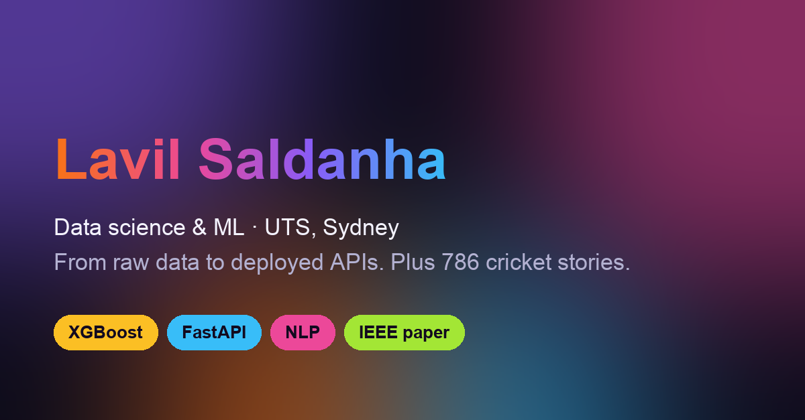

# lavil-portfolio

My personal portfolio site: the ML projects I've built at UTS, my IEEE paper, and four years of cricket writing at Sportskeeda, on one colourful page.

**Live:** deployed on Vercel (link in the repo's About section)



## What's in it

- **Work:** crypto trend forecasting API (XGBoost + FastAPI), Weather Intelligence API, BrewView semantic café search, an NBA career-longevity Python package, and AI credit scoring research
- **Writing:** a selection of my 786 Sportskeeda articles
- **Journey and toolkit:** how I got from engineering and sports media to data science

## How it's built

Plain HTML, CSS and a little JavaScript. No framework and no build step.

- `index.html`: all the content
- `styles.css`: the colour system, layout and responsive rules
- `script.js`: scroll-in animations and the stat counters, skipped when the visitor prefers reduced motion
- `assets/`: favicon and the social preview image

Every push to `main` redeploys the site on Vercel.

## Run it locally

```bash
python3 -m http.server 8000
```

Then open http://localhost:8000.
